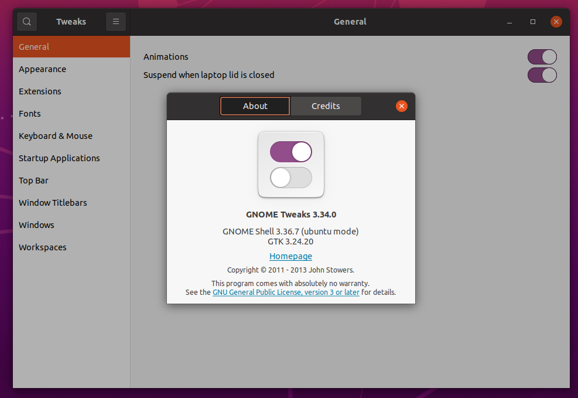
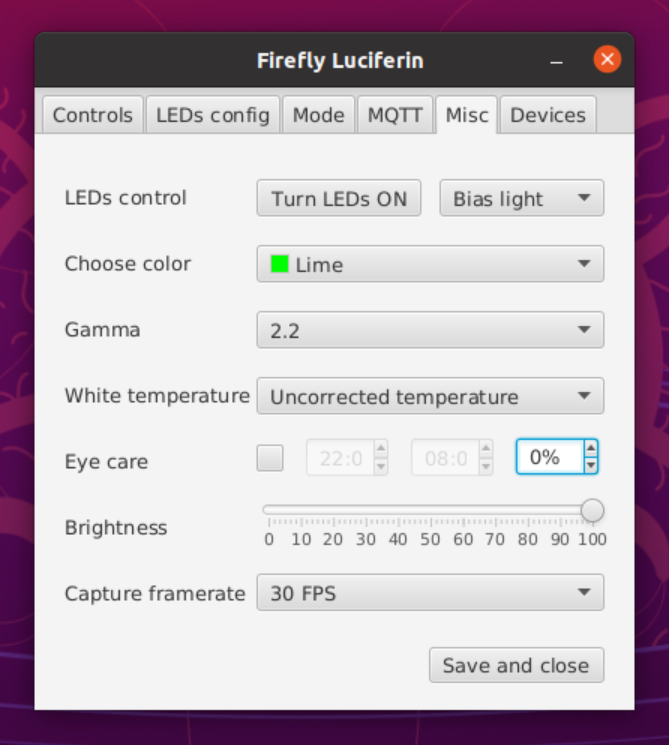
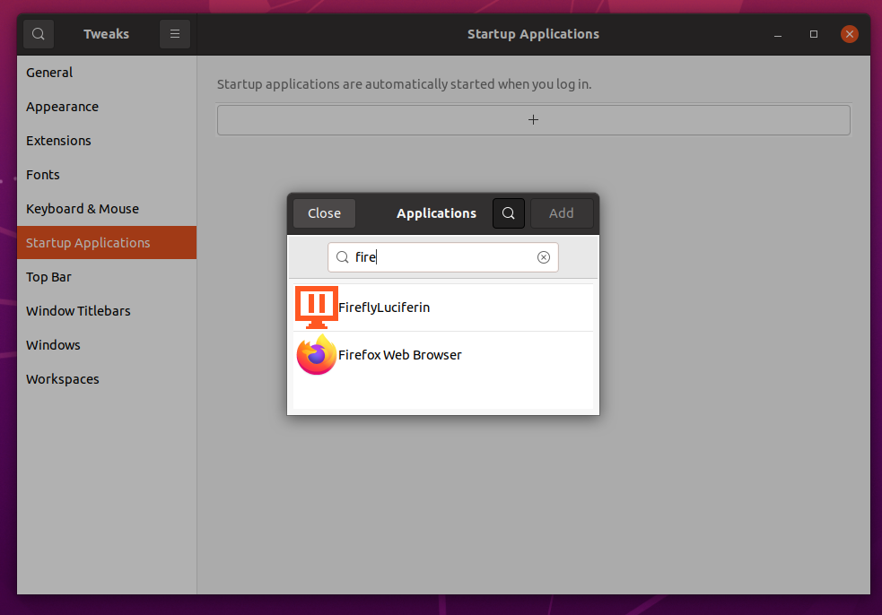

Firefly Luciferin supports **x86-64 and ARM64 Linux**, including Raspberry Pi with a 64-bit operating system. It can capture a Linux desktop or video from a USB capture card connected to an HDMI source.

## Installation

Choose a native **DEB/RPM** package from [Firefly releases](https://github.com/sblantipodi/firefly_luciferin/releases), or install through [Flathub](https://flathub.org/apps/org.dpsoftware.FireflyLuciferin) or the [Snap Store](https://snapcraft.io/fireflyluciferin). Store packages bundle dependencies and can simplify setup.

For an x86-64 native package, run the appropriate command from the download directory:

```bash
sudo dpkg -i FireflyLuciferinLinux.deb
```

or:

```bash
sudo rpm -Uvh FireflyLuciferinLinux.rpm
```

On ARM64, use the matching `FireflyLuciferinLinux_arm64.deb` or `FireflyLuciferinLinux_arm64.rpm` filename instead.

Native packages install the executable at:

```text
/opt/fireflyluciferin/bin/FireflyLuciferin
```

This path does not apply to Flatpak or Snap installations. The Arch Linux [AUR package](https://aur.archlinux.org/packages/firefly-luciferin-git) is not officially supported.

## Desktop or browser control

Firefly automatically detects whether a desktop is available. With a desktop, you can use the **dedicated desktop interface** as well as the **web interface**. Without a desktop, use the web interface from another device.

On the host, open `http://localhost:8091`. From your phone or another computer on the same network, use the host's IP address, for example `http://192.168.1.50:8091`. Browser control requires the **Web / MCP server** setting to remain enabled.


<!-- Screenshot: current Linux desktop interface alongside Firefly's web interface. -->

For a Raspberry Pi with limited RAM, using an operating system without a desktop leaves more resources available for capture. A desktop can offer additional customization options when memory permits. See [Remote Access](https://github.com/sblantipodi/firefly_luciferin/wiki/Remote-Access) for browser controls.

## Choose what to capture

In the **Mode** tab, use **Bind to display** to select the monitor or USB capture device, and leave **Capture method** on **AUTO** to let Firefly choose a suitable backend.

- **PC screen capture:** capture the desktop directly. This is the recommended setup for PC gaming.
- **HDMI capture:** connect a TV stick, console, or other HDMI source to a splitter. Send one output to the TV and the other to a USB capture card attached to the Linux PC or Raspberry Pi.

A Raspberry Pi can run this HDMI setup without a desktop or a nearby PC. See [Quick start](https://github.com/sblantipodi/firefly_luciferin/wiki/Quick-start) for the full wiring.

<!-- Screenshot: Mode tab with a USB capture card selected and Capture method set to AUTO. -->

## Wayland support and Hardware Acceleration

On Wayland, Firefly uses PipeWire and the desktop's screen sharing portal for desktop capture. **AUTO** selects the appropriate capture method; approve the screen sharing prompt if your desktop presents one.

Hardware acceleration reduces the CPU work needed to prepare frames for the LEDs. The available paths depend on your capture source, GPU, drivers, and installed media libraries. A CPU fallback is available when an accelerated path cannot be used.


<!-- Replace with a current capture-method screenshot showing AUTO and the available GPU options. -->

Start with **AUTO**. If you need to troubleshoot or compare performance, select one of the available methods manually. Options include **NVIDIA GPU**, **AMD/NVIDIA HIP GPU**, **AMD/INTEL GPU**, **OpenGL GPU**, and **CPU only**; the list changes with the selected source and desktop session.

### NVIDIA CUDA optimizations

The **NVIDIA GPU** methods use CUDA acceleration for supported capture paths, including X11 desktop capture, Wayland capture, and USB video.

Use a compatible GPU and working NVIDIA drivers. Native installations may also need the CUDA runtime and suitable [GStreamer plugins](https://gstreamer.freedesktop.org/documentation/installing/on-linux.html?gi-language=c). The Flatpak package bundles CUDA libraries; compatible host drivers are still needed.

### AMD and Intel optimizations

The **AMD/INTEL GPU** methods accelerate supported Wayland and USB capture paths. Install the appropriate graphics drivers and video acceleration libraries for your distribution.

Where supported, **AMD/NVIDIA HIP GPU** provides an additional acceleration path. Leave selection on **AUTO** unless you need to choose a specific backend.

### OpenGL optimizations

**OpenGL GPU** is another option for supported Wayland and USB capture sources. If GPU methods do not work on your system, try **CPU only**.

## How to configure Luciferin autostart

For a desktop setup, configure Firefly to start **after login** using your desktop's startup applications settings. On GNOME versions that provide this feature in **GNOME Tweaks**:

1. Install GNOME Tweaks if needed. On Debian based systems:

```bash
sudo apt install gnome-tweaks
```



2. Configure Firefly and enable **Turn LED ON** if you want lighting to start with the application.



3. Open **Startup Applications**, click **+**, select **Firefly Luciferin**, and add it.



Firefly will start the next time you log in. Other desktops have their own startup application settings.

For HDMI capture on a host without a desktop, follow [Start Firefly as a user service](https://github.com/sblantipodi/firefly_luciferin/wiki/systemctl). This configures startup without requiring a graphical login.

<sub>Thanks to @patrick-blom for the original GNOME startup guide.</sub>

## Firewall

If controller discovery, streaming, or browser access does not work, check the host's firewall rules for the local network.

| Port | Protocol | Purpose |
| --- | --- | --- |
| 4210 | UDP | Send LED colors to the controller |
| 5001, 5002, 5003 | UDP | Device discovery and broadcasts |
| 8091 | TCP | Firefly web interface |
| 8092 | TCP | Live preview connection setup |

Port **4210** is used to send data to the controller; it is not the web interface port. Live preview also uses WebRTC media connections, so allowing port 8092 alone may not be sufficient on a restrictive network.

MQTT uses your broker's configured port and is only needed if you enable MQTT.

## Audio features

Music effects require audio capture. Select the correct recording source in your system's audio mixer. To react to audio playing on the host, select a suitable playback monitor or loopback source rather than a microphone.

## Native Tray Icon

Firefly automatically uses `libayatana-appindicator3` or `libappindicator3` when available. Your desktop environment must also support application indicators for the tray icon to appear.


## Native Notifications

When `libnotify` is available, Firefly uses the desktop's native notifications.

