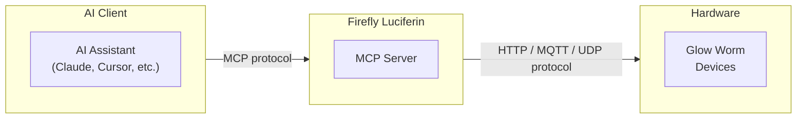

Keep **Web / MCP server** enabled in Firefly's **Mode** settings to use AI integration. Firefly must be running, with or without a desktop, and your AI client must support MCP over **Streamable HTTP**.

The MCP endpoint is **local to the machine running Firefly**: `http://127.0.0.1:33555/mcp`. A client on your PC cannot use its own `127.0.0.1` to reach Firefly running on a Raspberry Pi. For phone or browser control over the local network, use the separate [Firefly web interface](https://github.com/sblantipodi/firefly_luciferin/wiki/Remote-Access) on port **8091**.

## What is MCP?

The **Model Context Protocol (MCP)** is an open standard that allows AI assistants such as Claude Desktop, Cursor, Cherry Studio, and other MCP compatible clients to interact with applications through a standardized interface.

Firefly Luciferin includes a built in MCP server that exposes a set of tools allowing an AI assistant to:

* Retrieve information about your Firefly Luciferin instance.
* Discover connected Glow Worm devices.
* Change lighting effects.
* Automate common tasks using natural language.

Instead of navigating the UI manually, you can simply ask your AI assistant things like:

> "Set all LEDs to turquoise at 50% brightness."

or

> "Show me the currently connected Glow Worm devices."

The AI will call the appropriate MCP tool and Firefly Luciferin will perform the requested action.

---

## How it works

When Firefly Luciferin is running, it starts a local MCP server exposing a number of tools over **Streamable HTTP**.

The server runs locally and is **not exposed to the Internet**.

Typical architecture:



The AI assistant communicates with Firefly Luciferin through MCP, while Firefly Luciferin continues communicating with your Glow Worm devices using its normal protocols.

---

## Available tools

Depending on the version of Firefly Luciferin, the MCP server provides tools such as:

| Tool              | Description                                                                       |
| ----------------- | --------------------------------------------------------------------------------- |
| **Get Info**      | Returns information about the running Firefly Luciferin instance.                 |
| **Get Devices**   | Lists the detected Glow Worm devices and their status.                            |
| **Set Effect**    | Changes the currently active lighting effect.                                     |
| **Set Profile**   | Lists available profiles or applies a profile by name, restarting the instance.   |

Additional tools may be added in future releases.

---

## Configuring your AI client

Every MCP client has its own configuration format, but the only information you generally need is the local HTTP endpoint exposed by Firefly Luciferin.

The endpoint is available only while Firefly Luciferin is running.

Example configuration:

```
http://127.0.0.1:33555/mcp
```

Refer to your AI client's documentation for the exact configuration syntax.

---

## Example prompts

Once configured, you can simply chat with your AI assistant.

Examples:

* "List all my Glow Worm devices."
* "What effect is currently active?"
* "Switch to Rainbow."
* "Set the LEDs to Solid Blue."
* "Tell me information about my Firefly Luciferin instance."

The assistant will automatically choose the correct MCP tool without requiring you to know any implementation details.

---

## Security

The MCP server is designed to operate **locally**.

* It listens only on the local machine.
* It is intended to be accessed by trusted local AI clients.
* No cloud service is required.
* Your lighting devices remain under your local control.

---

## Technical notes

Firefly Luciferin implements a lightweight MCP server based on the **Streamable HTTP** transport defined by the Model Context Protocol specification. The server exposes a collection of tools that allow AI clients to inspect the current application state and execute supported lighting commands through standard MCP tool calls.
