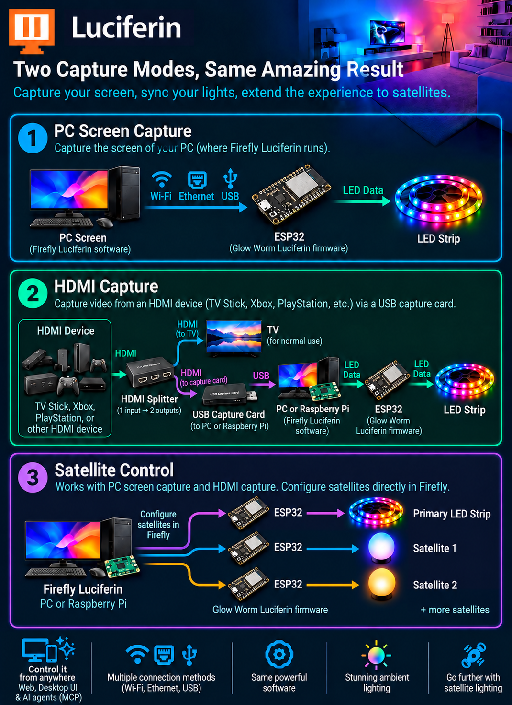

## Build your first Luciferin setup

Luciferin turns the colors in your games, movies, and shows into lighting around your screen. This guide takes you from choosing a capture mode to seeing your LEDs follow the image.

You will install two components:

- **Firefly Luciferin** on a PC or Raspberry Pi: captures the video and calculates the LED colors.
- **Glow Worm Luciferin** on the LED controller: receives those colors and drives the strip.

## 1. Choose your capture mode

| | PC screen capture | HDMI capture |
| --- | --- | --- |
| **What you want to light** | Games, applications, and video shown on your PC | Video from a console, TV stick, or another external HDMI source |
| **Where Firefly runs** | On the PC whose screen you capture | On a Windows/Linux PC or a supported Linux ARM64 system such as Raspberry Pi |
| **Extra capture hardware** | None | A USB HDMI capture card and a way to feed the video to both the TV and the capture card |

**For PC gaming, choose direct PC screen capture.** Running Firefly on the gaming PC avoids the extra capture hardware and processing path of an HDMI/Raspberry Pi setup, making it the more responsive choice.

The capture mode and the connection to the LED controller are separate choices. **Using a USB capture card does not require sending LED colors over USB:** you can still use WiFi or Ethernet between Firefly and Glow Worm.

### Option A: capture your PC screen

Firefly runs on your Windows or Linux PC and captures the selected monitor:

**PC screen → Firefly → Glow Worm controller → LED strip**

You do not need a capture card or an HDMI splitter. For multiple monitors, start with one screen, then follow the [multi monitor guide](https://github.com/sblantipodi/firefly_luciferin/wiki/Multi-monitor-support).

### Option B: capture an HDMI source

Firefly receives video from a USB capture card instead of capturing the host computer's screen. A splitter based setup has these connections:

1. Connect the HDMI source to the **HDMI splitter input**.
2. Connect one splitter output to the **TV**.
3. Connect the other splitter output to the capture card's **HDMI input**.
4. Connect the capture card's **USB output** to the PC or Raspberry Pi running Firefly.

The TV displays the source as usual, while Firefly uses the captured video to calculate the lighting colors.

**The Raspberry Pi replaces the PC running Firefly; it does not replace the Glow Worm LED controller.** Firefly must remain running while you use video synchronized lighting.

## 2. Gather the hardware

For either capture mode, you need:

- **A host for Firefly:** your Windows/Linux PC, or a Raspberry Pi with a supported 64-bit Linux installation for HDMI capture.
- **A compatible LED controller:** ESP8266 or ESP32, with ESP32-S3 recommended for a new setup.
- **An addressable LED strip:** SK6812 is recommended; see [RGB and RGBW support](https://github.com/sblantipodi/firefly_luciferin/wiki/RGB-and-RGBW-support).
- **A suitable power supply** for your strip and controller, plus the required wiring.

For HDMI capture, also include the capture card, HDMI cables, and splitter described above.

### Recommended HDMI hardware

| Component | Recommended options |
| --- | --- |
| HDMI splitter | [Model and link to be added: option 1]; [Model and link to be added: option 2] |
| USB HDMI capture card | [Model and link to be added: option 1]; [Model and link to be added: option 2] |

<!-- EDITOR: Replace the product placeholders above with tested splitter and USB capture card recommendations. -->

See [compatible hardware](https://github.com/sblantipodi/firefly_luciferin/wiki/Compatible-Hardware) for controllers, strips, and power supplies. You can also use an [official PCB](https://github.com/sblantipodi/firefly_luciferin/wiki/Ready-to-print-PCB) to simplify assembly.

**MQTT and Home Assistant are optional.** You do not need either to get video synchronized lighting working.

## 3. Install Glow Worm on the LED controller

Connect the controller to your computer and open the [Glow Worm Web Installer](https://sblantipodi.github.io/glow_worm_luciferin). Choose the firmware matching your board and the connection you want to use.

| Firmware | Connection | When to choose it |
| --- | --- | --- |
| **FULL** | Requires WiFi or Ethernet; USB is optional | For network streaming, controller web access, satellites, and automatic firmware updates |
| **LIGHT** | USB between the Firefly host and controller | For a basic setup without controller network features |

For FULL firmware, configure the controller's WiFi or Ethernet connection. The [network setup guide](https://github.com/sblantipodi/firefly_luciferin/wiki/Remote-Access) walks through installation and configuration with screenshots.

Alternatively, download firmware from the [Glow Worm releases](https://github.com/sblantipodi/glow_worm_luciferin/releases) and [flash it with esptool](https://github.com/sblantipodi/firefly_luciferin/wiki/How-to-flash-Glow-Worm-Luciferin-firmware-via-esptool).

<!-- SCREENSHOT: Current Web Installer showing firmware selection and WiFi network picker. -->

## 4. Connect and position the LED strip

Follow the wiring diagram for your controller and strip:

- Connect the strip's data input to the configured controller GPIO, and connect the grounds together. See [supported GPIO and baud rate](https://github.com/sblantipodi/firefly_luciferin/wiki/Supported-GPIO-and-Baud-Rate).
- Match the power supply voltage to your hardware. The diagram illustrates a 5V setup; follow your board's power specifications.
- If the controller will run without USB power, provide power through the appropriate input for that board.
- Depending on your hardware, a capacitor, resistor, or logic level converter may be needed for a stable signal.

Mount the strip behind your monitor or TV. Double sided tape makes positioning straightforward; either clockwise or counterclockwise installation is supported.

Note the number of LEDs along each edge, the strip direction, and the position of the first LED. You will enter these in Firefly.

## 5. Install Firefly on the capture host

- **Windows:** use the [Firefly installer](https://github.com/sblantipodi/firefly_luciferin/wiki/Installers-and-binaries).
- **Linux or Raspberry Pi:** use the package matching your system and architecture; see [Linux support](https://github.com/sblantipodi/firefly_luciferin/wiki/Linux-support). For Raspberry Pi, choose an ARM64 installation.

### Using Firefly on Raspberry Pi

Choose your Raspberry Pi model and operating system according to your preferences, using a supported 64-bit Linux installation. **Firefly automatically detects whether a desktop is available and starts in the appropriate mode.** You do not need to select a separate version manually.

- **The web interface is always available**, so you can control Firefly from your phone or another computer.
- **The dedicated desktop interface is available when a desktop environment is present.** It offers some additional customization options, while web control remains available too.

If your Raspberry Pi has limited RAM, an installation without a desktop is recommended to leave more memory available for capture and processing. With enough RAM, a desktop installation lets you use the dedicated desktop interface as well.

Open the [Firefly web interface](#control-firefly-from-your-phone), or use the dedicated desktop interface if available, and select the firmware type installed on your controller: **FULL** or **LIGHT**.

The following setup steps describe the settings in the dedicated desktop interface. If you use web control, open the corresponding settings in the web interface.

<!-- SCREENSHOT: Current first-launch firmware selection. The previous init.png can be reused if its UI is still current. -->

## 6. Configure the source, controller, and layout

### Select the video source

In the **Mode** tab, use **Bind to display** to choose your source:

- **PC screen capture:** select the monitor you want to capture.
- **HDMI capture:** select the USB capture card by its device name. Connect the card before selecting it.

Leave **Capture method** on **AUTO** for your first setup. Firefly selects the capture method for the source and operating system, including supported acceleration paths. You can choose a specific method later if needed.

<!-- SCREENSHOT: Mode tab with the source selector open, showing monitors and a USB capture card, with Capture method set to AUTO. -->

### Select the LED controller

Open the **Devices** tab:

- **FULL firmware:** Firefly discovers controllers on the network. Select the intended **Output device**, particularly if you have more than one.
- **LIGHT firmware:** connect the controller to the Firefly host over USB and select its serial port.

Baud rate and output device settings are now in the **Devices** tab. For network discovery, ensure the host and controller can communicate on your local network; see [auto discovery](https://github.com/sblantipodi/firefly_luciferin/wiki/Static-IP-and-auto-discovery) if the device is missing.

<!-- SCREENSHOT: Devices tab showing output device selection, serial connection settings, and detected controller. -->

### Match the layout to your strip

Open the **LED** tab and set the LED counts for each edge, **Orientation**, and **First LED offset** to match your installation. Configure a **Bottom Gap** if your strip has a gap along the bottom edge.

Save the configuration. With a desktop available, use **Test image** to check that each part of the image maps to the correct part of the strip; see the [Test Image guide](https://github.com/sblantipodi/firefly_luciferin/wiki/Test-image-and-latency-test) for adjustments. Without a desktop, use web live preview to verify the capture input and check the LEDs while playing a familiar scene.

<!-- SCREENSHOT: LED tab with a simple four-sided layout and the Test image button. -->

## 7. Start your ambient lighting

Select the **Bias light** effect and start capture. In the desktop app, you can also start or stop bias lighting by double clicking the tray icon.

Play a colorful scene on your selected source and check that the LEDs follow it. Firefly sends your configured LED count to the controller when bias lighting starts; the firmware's initial default is 50 LEDs.

If the result is incorrect, check these first:

- **Wrong image or no captured image:** verify the selected monitor or USB capture card and its connections.
- **Controller not found:** check the network connection for FULL firmware, or the USB connection and serial port for LIGHT firmware.
- **Colors appear on the wrong edge:** check orientation, LED counts, and first LED offset with Test Image.
- **Red, green, or blue are swapped:** check the controller's color order and strip type. See [RGB and RGBW support](https://github.com/sblantipodi/firefly_luciferin/wiki/RGB-and-RGBW-support).

## Control Firefly from your phone

The dedicated **Firefly web interface** lets you configure and control the running application from your phone while sitting on the couch.

1. Keep Firefly running and **Web / MCP server** enabled in the **Mode** tab.
2. Connect your phone to the same local network as the Firefly host.
3. Open `http://<Firefly-host-IP>:8091/` in your phone's browser, replacing `<Firefly-host-IP>` with the PC or Raspberry Pi's local IP address.

On the host itself, open `http://localhost:8091/` or choose **Web interface** from the tray menu.

**Firefly and Glow Worm have separate web interfaces:** the address above controls Firefly on the PC or Raspberry Pi. The controller's own IP address opens the Glow Worm firmware interface. See [remote access](https://github.com/sblantipodi/firefly_luciferin/wiki/Remote-Access) for controller configuration.

<!-- SCREENSHOT: Firefly web interface on a phone, showing lighting controls and settings. -->

## Where to go next

Once basic capture works, explore the features that matter to your setup:

- [Adaptive gamma and white balance](https://github.com/sblantipodi/firefly_luciferin/wiki/Color-Temperature-and-White-Balance) for color tuning.
- [Smoothing color transitions](https://github.com/sblantipodi/firefly_luciferin/wiki/Smoothing-color-transitions) for smoother lighting changes.
- [Compression and the live overlay](https://github.com/sblantipodi/firefly_luciferin/wiki/Lossless-compression-and-overlay) to inspect LED output and transmission.
- [Surround lighting with satellites](https://github.com/sblantipodi/firefly_luciferin/wiki/Surround-lighting-with-satellites) to extend lighting around the room, with either capture mode.
- [Profiles](https://github.com/sblantipodi/firefly_luciferin/wiki/Profiles), [Home Assistant](https://github.com/sblantipodi/firefly_luciferin/wiki/Home-Automation-configs), and [AI control through MCP](https://github.com/sblantipodi/firefly_luciferin/wiki/MCP-and-AI-Agents).

Need a hand? Visit the [Discord community](https://github.com/sblantipodi/firefly_luciferin/wiki/Luciferin-Discord-server).
