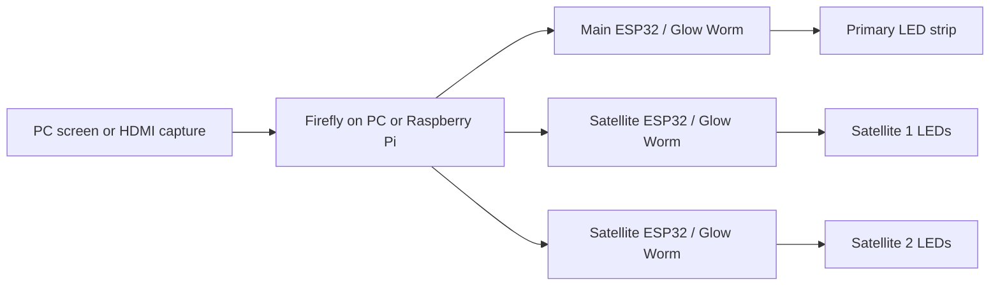

Satellites extend your screen lighting to other LED strips around the room. A light on the left can follow the left side of the image, while another follows the right or the whole scene.

**Satellites work with both PC screen capture and HDMI capture.** Configure them in Firefly; each controller runs Glow Worm FULL firmware and drives its own LEDs.

## How the devices connect

Firefly sends colors directly to the main controller and each satellite controller over the network. The primary controller does not relay those colors to the satellites.

See the [connection overview in Quick start](https://github.com/sblantipodi/firefly_luciferin/wiki/Quick-start#1-choose-your-capture-mode) for an illustrated setup.

<!-- Optional illustration: add a crop of the satellite section from data/img/luciferin-capture-overview-v4.png. -->

### How to configure satellites

Open **Devices → Satellite Manager** in Firefly's dedicated desktop interface, or the satellite settings in its web interface.

1. Enter the satellite controller's **IP address**.
2. Choose its **display zone**, such as left, right, top, bottom, or all zones. For a named custom zone, configure it in the [Test Image](https://github.com/sblantipodi/firefly_luciferin/wiki/Test-image-and-latency-test).
3. Enter the **number of LEDs** connected to that controller.
4. Choose the algorithm:
   - **Average:** preserves color variation across the selected zone, adapting it to the satellite's LED count.
   - **Average on all LEDs:** fills the satellite with one average color from its selected zone.
5. Check the strip orientation, add the device with **+**, and confirm the settings.

<!-- Screenshot: current desktop Satellite Manager and web satellite settings, including orientation. -->

### Notes

- Use **FULL firmware** and **UDP network streaming**. The connection is IP based; WiFi or Ethernet can be used with suitable controllers.
- Each satellite adds processing and network traffic. Expand the setup gradually and check that the lighting remains responsive.
- Capture starts once the configured satellites are ready. If it does not start, check that every satellite is online and its IP address is correct.
